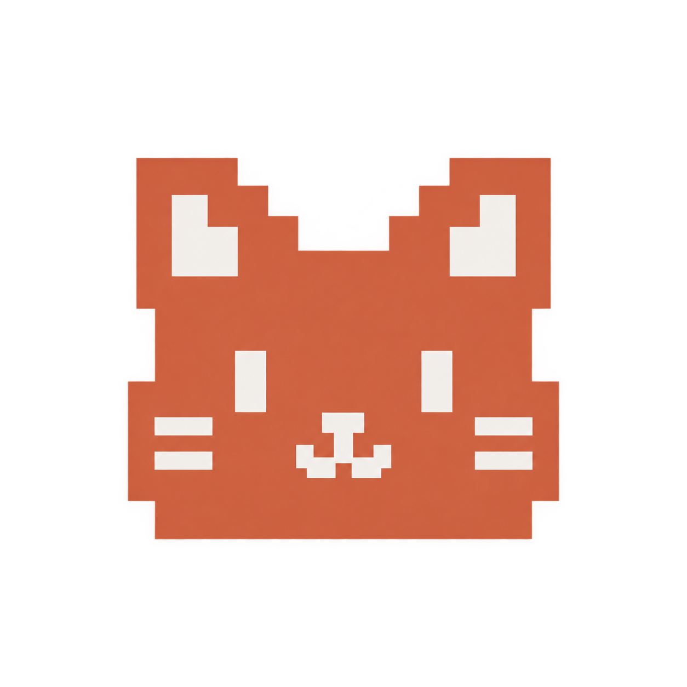
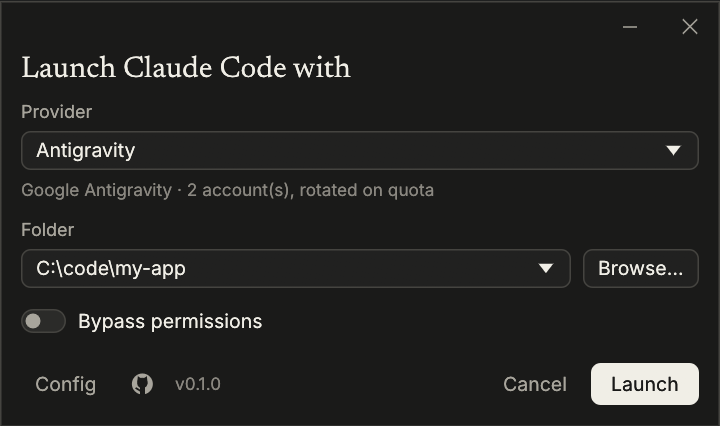

<p align="center"></p>

# ccat

**Claude Code, any model.** ccat is a small native launcher written in Rust: pick a provider and a folder, and it runs `claude` in your terminal against that provider. The main target is **Google Antigravity**: your Google accounts' Antigravity quota (Gemini, Claude, GPT-OSS) behind the Claude Code harness you already know. Any Anthropic-compatible endpoint works as well.

<p align="center">
  
  &nbsp;
</p>

```
ccat              # pick a provider/model per tier + folder, then Claude Code starts in this terminal
ccat --resume     # extra arguments go straight to claude
ccat --version    # the only flag ccat keeps for itself
```

ccat never edits your Claude config. Every override lives only in the child process's environment and flags, so a plain `claude` session stays exactly as it was.

## Why

- **All in one app.** No editing `settings.json`, no exporting `ANTHROPIC_BASE_URL` / `ANTHROPIC_AUTH_TOKEN` / model variables by hand. URLs, keys, Google accounts and per-tier models live in profiles you set up once in the UI. Switching between them is one click before launch.
- **A proxy built in.** Antigravity is served by a proxy inside ccat itself. For this use case you don't need a separate router such as 9Router or OmniRoute to sit between Claude Code and the model.
- **Claude Code on Antigravity.** Antigravity's quota is generous, but its agent isn't Claude Code. ccat gives you both: Claude Code's skills, hooks, plugins, subagents, MCP servers and permission model, running on Antigravity models, plus the Antigravity abilities Claude Code has no tool for.
- **Small and fast.** One native Rust binary: egui UI, plain blocking HTTP, no Node, no Python, no Docker, no background service. The proxy is a thin translation layer that only runs while your Claude Code session does.

## ccat vs Antigravity

What Antigravity (the IDE / `agy` CLI) offers, and where ccat stands on each:

| Capability                            |      Antigravity      |  ccat (Claude Code)  | Notes                                                                   |
| ------------------------------------- | :-------------------: | :------------------: | ----------------------------------------------------------------------- |
| Gemini models                         |          ✅           |          ✅          | Served by ccat's local proxy                                            |
| Claude / GPT-OSS on Antigravity quota |          ✅           |          ✅          | Same Cloud Code backend, same quota buckets                             |
| Agent harness                         |   Antigravity agent   |    ✅ Claude Code    | Skills, hooks, plugins, subagents, MCP, plan mode, `/context`           |
| Web search (Google Search)            |          ✅           |          ✅          | Google Search grounding; see [Special features](#special-features)      |
| Image generation / editing            |  ✅ `generate_image`  |          ✅          | Bundled MCP tool `mcp__antigravity__generate_image`                     |
| Several Google accounts               | One signed-in account |          ✅          | Pool with automatic rotation when one runs out                          |
| Quota in the status line              |      ✅ built-in      |          ✅          | `statusline/` script, next to your Claude plan limits                   |
| Third-party providers                 |      Google only      |          ✅          | Any Anthropic-compatible endpoint (OpenRouter, gateways, local servers) |
| Exact token counts                    |          ✅           | ✅ Gemini / ≈ others | Google's counter on Gemini routes; a calibrated estimate elsewhere      |
| Browser agent                         |          ✅           |          ❌          | Not bridged. Use a browser MCP server in Claude Code instead            |
| Knowledge / "brain" memory            |          ✅           |          ➖          | Claude Code has its own memory (`CLAUDE.md`, auto memory)               |
| Voice input, remote control           |          ✅           |          ❌          | Not bridged                                                             |

✅ supported · ➖ covered differently by Claude Code · ❌ not supported

## Special features

- **Antigravity Web Search.** Claude Code's `WebSearch` runs as Google Search grounding, and the results come back as Anthropic web-search blocks, so citations and follow-up `WebFetch` work as usual. Grounding only runs on Gemini, so a search asked of a Claude or GPT route is delegated to Gemini Flash and the result goes back to the model you picked.
- **Image generation and editing.** ccat registers an `antigravity` MCP server with Claude Code. Its `generate_image` tool uses Gemini's image model and can take existing images as references. Files are saved relative to your project folder.
- **Account pool with failover.** Add as many Google accounts as you like. Requests stick to one account and move to the next when Google reports quota exhaustion. Quota is tracked per model family (Gemini, Claude, GPT), so an account out of Claude quota still serves Gemini. Retry delays are read from Google's error.
- **A provider per tier, switchable while it runs.** Fable, Opus, Sonnet and Haiku each pick their own `provider / model`: for example Fable and Opus on your official Claude login, Sonnet on Antigravity, Haiku on OpenRouter. Change a tier under **Settings → Models & tiers** and running sessions use it from their next request. Each tier can also have an ordered **fallback chain**, tried in turn when its provider is down or out of quota. A whole setup of the four tiers is a **configuration**: switch, duplicate, rename, import or delete them from the button above the tiers (in the launcher and in Settings); each is a small file in `%APPDATA%\ccat\profiles\`. Claude tiers keep Claude Code's own login and plan limits; the local proxy only forwards them. The provider pages (**Settings → Claude**, **Antigravity**, **ChatGPT**, **Ollama**, **MuseAI** and each endpoint) have an on/off switch: off hides it from the pickers and stops routing to it, live in running sessions.
- **Routing safeguards.** **Settings → Routing** has *Wait out usage limits* (when every route and fallback of a request is at its limit, the request waits instead of failing; Esc still cancels) and *Never fall back to a paid API key* (custom endpoints are skipped as fallbacks; a tier's own first choice still runs). A circuit breaker skips a provider for 30 s after 3 consecutive 5xx or timeouts, then lets one request probe it; 429s never trip it, and if every route is skipped all of them are tried.
- **Token saving.** **Settings → Token saving** has an opt-in *Compress tool output (third-party models)*: a lossless cleanup of Bash/PowerShell command output only (ANSI colours, progress redraws rendered like a terminal, trailing spaces, runs of identical lines). It is deterministic, so provider prompt caches keep hitting, and it never touches Claude, error results or file reads.
- **Claude names for any model.** A non-official tier can be presented to Claude Code under a Claude model name. Claude Code then applies that model's catalog entry (context window, thinking), while the request still goes to the real model.
- **Faithful translation.** Streaming and non-streaming Messages ↔ Cloud Code `streamGenerateContent`, thinking blocks and their signatures (safe across model switches and resumed sessions), and tool schemas normalized to what every Antigravity model family accepts.
- **Quota status line.** One PowerShell script feeds both status lines: in `agy` it records the quota Antigravity hands it, and in Claude Code it shows that quota next to context use and your Claude plan limits, as smooth bars:

  ```
  ◔ ▌░░░░░░░ 7% │ ✻ Claude 5h █▉░░░░░░ 24% 7d ████▍░░░ 55% │ ▲ ◇ Claude/GPT 5h ▏░░░░░░░ 2% 7d ▎░░░░░░░ 3%
  ```

  The Gemini bucket shows in `agy`'s line only. The Claude/GPT bucket (`◇`) appears only when a tier runs a non-Gemini model on Antigravity.

- **Usage tray (Windows).** While any ccat runs, one tray icon shows your quota as a dial: Claude's 5-hour percent above, Antigravity's below, each inside a half ring of its weekly use (one source alone takes the whole dial). Click it for the window: **Usage** lists every Claude limit and Antigravity's Gemini and Claude groups (all Google accounts combined or one at a time), and **Analytics** charts the tokens ccat's proxy has seen per day by model or provider. Its gear button, like the launcher's settings button and the icon's right-click **Settings**, opens the Settings window (`ccat --ccat-settings [page]`, one instance), where tier models and configurations switch live. However many ccat sessions run, there is one icon and one usage window. Claude's numbers come from Claude Code's own login, which ccat reads but never refreshes.
- **Stays current.** The backend gates newer models on the client version, so ccat reports the live Antigravity release version, and the list of Claude model names comes from [models.dev](https://models.dev), checked at most every six hours.

## Providers

| Provider                                   | What it does                                                                                                                                                                                                      |
| ------------------------------------------ | ----------------------------------------------------------------------------------------------------------------------------------------------------------------------------------------------------------------- |
| **Claude** (official)                      | Your normal Claude Code login. A tier left at Claude with Claude Code's pick changes nothing; all four there is plain `claude`.                                                                                     |
| **Google Antigravity**                     | Sign in with one or more Google accounts in the browser. ccat provisions the Cloud Code project, lists the models your accounts can use, and serves them through a local proxy while Claude Code runs.            |
| **ChatGPT**                                | Your ChatGPT Plus/Pro plan behind Claude Code: the GPT models Codex uses, signed in the way Codex signs in. See [ChatGPT](#chatgpt) and [ccat vs Codex](#ccat-vs-codex).                                         |
| **Ollama**                                 | Run local models (Qwen, Llama, DeepSeek) through Ollama. ccat translates Anthropic Messages to Ollama's native `/api/chat` with a fixed 64k `num_ctx` and `keep_alive` 30m (the OpenAI-compatible API ignores both), effort mapped to low/medium/high thinking (models without thinking support are retried without it), and tool support. No key needed for a local Ollama. |
| **MuseAI**                                 | Sign in with your MuseAI account in Chrome (the **+** under **Settings → MuseAI**). ccat bridges Anthropic Messages to Meta's Hatch VM Gateway with isolated sessions and buffered replies. |
| **Anthropic-compatible endpoint** (custom) | Any server that speaks the Anthropic Messages API: OpenRouter, an API gateway, a local model server. Set a URL and key, **Fetch model list** (Anthropic- or OpenAI-style `/v1/models`), or type custom model ids. Claude Code's per-request billing line is stripped from the system prompt so the endpoint's prompt cache sees a stable prefix. |

Providers are connections: add, rename, turn off and delete them in **Settings** (the sidebar lists Claude, the built-ins and each endpoint, plus **+ Add endpoint**; the launcher's settings button opens it), then pick `provider / model` for each tier in the launcher. With every tier on Claude and no fallback, ccat runs plain `claude`, straight to Anthropic; anything else goes through the local proxy, which is what lets a session switch models and fall back while it runs.

## ChatGPT

Use your ChatGPT plan, not an API key, for the GPT models. ccat shares **Codex CLI's login**: sign in with `codex login` (the **+** under **Settings → ChatGPT** opens a terminal for it) and that account shows up in ccat, with its plan. ccat reads Codex's `~/.codex/auth.json` fresh on every request and never refreshes, writes or signs it out — Codex keeps it fresh whenever it runs.

Why not a sign-in of ccat's own: a second sign-in with Codex's login client makes OpenAI revoke the earlier sessions, which signs you out of Codex on every device. Sharing the one session avoids that. Requests go to the Codex backend (`chatgpt.com/backend-api/codex`), the way Codex CLI sends them; OpenAI doesn't officially support that for other apps, so it may change. If the login is revoked or expires, ccat says so ("run `codex login`") instead of retrying.

Usage: the ChatGPT section of the usage window shows the session (5 h) and weekly limits of that login, the same numbers Codex shows. **Manage usage** opens [chatgpt.com/settings/usage](https://chatgpt.com/settings/usage).

## ccat vs Codex

What Codex (the CLI / app) offers on a ChatGPT plan, and where ccat stands on each:

| Capability                         |        Codex         |  ccat (Claude Code)  | Notes                                                                                   |
| ---------------------------------- | :------------------: | :------------------: | --------------------------------------------------------------------------------------- |
| GPT models on your ChatGPT plan    |          ✅          |          ✅          | Same list as Codex's model catalogue, display names included                            |
| Reasoning effort                   | ✅ low … max, ultra  |   ✅ low … max       | Claude Code's `/effort` maps 1:1; no effort = the model's Codex default. *Ultra* (Codex's own task delegation) isn't sent |
| Fast mode (priority tier)          |          ✅          |          ➖          | Off on purpose: ccat never asks for the priority tier                                   |
| Web search                         |          ✅          |          ✅          | Claude Code's `WebSearch` runs as the Responses `web_search` tool, with citations         |
| Image input                        |          ✅          |          ✅          | Screenshots and pasted images reach the model                                           |
| Image generation                   |          ✅          |          ❌          | Not bridged yet                                                                          |
| Reasoning carried across turns     |          ✅          |          ✅          | Encrypted reasoning is replayed; it never leaks to Anthropic routes                      |
| Prompt caching                     |          ✅          |          ✅          | Keyed on the Claude Code session                                                         |
| Usage limits (5 h / weekly)        |          ✅          |          ✅          | Usage window and tray dial                                                               |
| Fallback when ChatGPT is limited   |          ❌          |          ✅          | Fallbacks to Claude, Antigravity or any endpoint per tier                               |
| Agent harness                      |     Codex agent      |    ✅ Claude Code    | Skills, hooks, plugins, subagents, MCP, plan mode                                        |
| `AGENTS.md`, sandbox, approvals    |          ✅          |          ➖          | Claude Code's `CLAUDE.md`, permission modes and *Bypass permissions*                     |
| `/review`                          |          ✅          |          ➖          | Claude Code's code-review commands and plugins                                           |
| Compaction                         |   ✅ server-side      |          ➖          | Claude Code compacts the conversation itself                                             |
| Cloud tasks, remote control        |          ✅          |          ❌          | Not bridged                                                                              |
| Mixing with Claude, Gemini, others |          ❌          |          ✅          | One tier on GPT, another on Claude or Antigravity, switchable while a session runs       |

✅ supported · ➖ covered differently by Claude Code · ❌ not supported

## MuseAI Support Matrix

MuseAI runs inside ccat using native Rust HTTPS, Noise WebSocket encryption and Protobuf transport to Meta's Hatch VM Gateway. No Python runtime or local gateway process is started. Existing `http://127.0.0.1:18615` configurations select this native transport; custom remote gateway URLs still work.

### Capability Matrix

| Capability | Priority | ccat Status | Technical Implementation & Notes |
| :--- | :---: | :---: | :--- |
| **Local tool call loop & multiturn** | P0 | ➖ Prompt-based adapter | Declared names and argument schemas are validated before returning calls to the client. A live tool-call → client result → final answer passed, but a repeat of the same test returned ordinary text instead. Upstream structured tool support is unverified. |
| **Streaming & cancellation** | P0 | ➖ Buffered response | History polling returns the completed answer over SSE with heartbeats, not token streaming. Isolated history can expose partial text, but append-only progression is unproven. Each request has an isolated session, cleaned up on completion or cancellation. Live reader-drop cancellation verified. |
| **Quota display & tray dial** | P0 | ✅ Supported | Usage is fetched live from muse.ai's subscription endpoint with your signed-in session (plan, weekly limit and reset, additional tokens). A failed fetch greys out the last known bars instead of showing stale numbers. |
| **Model selection & tier routing** | P1 | ✅ Supported | Supported as a first-class built-in provider in `ccat` routing tiers with fallback support. Default model: `muse-chat`. |
| **Image input (code screenshots)** | P1 | ➖ Planned | Vision payload mapping planned for compiler error and UI screenshot analysis. |
| **Web search & citations** | P1 | ➖ Planned | Native search controls and source attribution planned for future updates. |
| **Account auth & concurrency** | P1 | ✅ Supported | One-click browser sign-in via dedicated Chrome window (**+** in Providers); stores validated session in `~/.config/muse-cli/cookies.txt`. |
| **Image & video generation** | Deferred | Out of scope | Low priority for core coding workflows; focused on coding agent loops. |

### Technical Architecture
- **Native gateway**: `src/providers/museai/native.rs` owns HTTPS authentication and each Noise connection. Chat does not spawn Python or Chromium. Protocol attribution is in [THIRD_PARTY.md](THIRD_PARTY.md).
- **GUI Management**: Providers view offers a one-click **+** sign-in action in Chrome with automatic account discovery, session validation, and model refresh.

Unit-test builds store ccat configuration under a process-specific temporary directory, including launcher shutdown saves. They never save test profiles to the installed app's configuration. Live Muse checks are opt-in: `cargo test live_native_ -- --ignored --test-threads=1`. These checks use the existing Muse login, spend a few requests and delete their temporary remote sessions.

Claude Code's `ENABLE_TOOL_SEARCH=true` loads tools on demand. ccat resolves discovered tool definitions for MuseAI, ChatGPT, Antigravity and Ollama, preserving their schemas and tool results. Official Claude requests are forwarded unchanged. Setting tool search to `false` loads every MCP definition upfront and can substantially increase context size.

## Install

You need [Claude Code](https://docs.claude.com/en/docs/claude-code) (`claude`) on your `PATH`. ccat itself is a single `ccat.exe`.

**winget** (Windows):

```powershell
winget install duongnguyen16.ccat
```

> The winget package was submitted to [microsoft/winget-pkgs](https://github.com/microsoft/winget-pkgs/pulls?q=duongnguyen16.ccat) and goes live once that review is merged. Until then, use one of the options below.

**Download:** grab `ccat-v<version>-x86_64-windows.zip` from the [latest release](https://github.com/duongnguyen16/ccat/releases/latest), unzip it, and put `ccat.exe` somewhere on your `PATH`. The binary is not code-signed, so Windows SmartScreen may ask you to confirm the first run.

**From source** (needs [Rust](https://rustup.rs)):

```bash
git clone https://github.com/duongnguyen16/ccat
cd ccat
cargo install --path .
```

Check it with `ccat --version`. Then run `ccat` in any terminal: add your first provider in **Settings**, pick a folder and press **Launch**.

Developed and used on Windows. The UI (egui) and the proxy are cross-platform, but macOS and Linux are untested.

### Status line (optional, Windows PowerShell)

Claude Code, in `~/.claude/settings.json`:

```json
"statusLine": {
  "type": "command",
  "command": "powershell -NoProfile -ExecutionPolicy Bypass -File C:/path/to/ccat/statusline/quota-statusline.ps1"
}
```

Antigravity CLI, in `~/.gemini/antigravity-cli/settings.json` (or run `/statusline <command>` inside `agy`):

```json
"statusLine": {
  "enabled": true,
  "command": "powershell -NoProfile -ExecutionPolicy Bypass -File C:\\path\\to\\ccat\\statusline\\quota-statusline.ps1 -Agy"
}
```

The Antigravity quota refreshes whenever `agy` is open. A dim `~Nh` marks a reading that is N hours old. Bars turn yellow at 50% and red at 80%.

## How it works

```
claude ──► ccat proxy (127.0.0.1, random port, per-launch token)
             ├─ POST /v1/messages, by the model's tier:
             │    ├─ Antigravity tier ──► Cloud Code streamGenerateContent ──► Anthropic SSE back
             │    ├─ endpoint tier    ──► that endpoint, with its key
             │    └─ official tier    ──► api.anthropic.com, with Claude Code's own login
             ├─ count_tokens          ──► same routes (Google countTokens / calibrated estimate on Antigravity)
             └─ /mcp                  ──► generate_image (Gemini image model)
```

- Official Claude request bodies are forwarded byte-for-byte as Claude Code sent them, with its headers (hop-by-hop ones aside). Only when a tier swaps the model, or another provider's thinking must be dropped, is the body rewritten, keeping key order.

- The proxy binds to `127.0.0.1` only, on a random port. Antigravity and endpoint tiers spend your accounts and keys, so they answer only requests carrying the token generated for that launch (sent as an `x-ccat-token` header). Official tiers carry only the caller's own login.
- Several ccat sessions can run at once: each has its own proxy, which follows model changes in the config; the config is saved atomically and merged field by field, and log lines carry the process id. Token counts for **Analytics** go to `tokens.jsonl` next to the config, one line per request.
- Config, including the Google refresh tokens, is stored in `%APPDATA%\ccat\config.json` (`$XDG_CONFIG_HOME/ccat` or `~/.config/ccat` elsewhere). Keep that file private.
- Proxy logs go to `antigravity.log` next to the config, since Claude Code owns the terminal while ccat runs.

### Source layout

- `src/proxy/`: `mod` (routing, fallback chains, breaker use), `http`, `sse`, `compress` (tool-output cleanup), `breaker`.
- `src/providers/`: `claude`, `endpoint`, `antigravity/`, `chatgpt/`, `ollama`, `museai/`. Each owns its auth, translation, pooling, web search, usage and its Settings page.
- `src/settings/`: the Settings window, its sidebar and the provider editor state its provider pages share.
- `src/common.rs`: helpers shared across the above.

## Notes

- Antigravity's Cloud Code API is internal and undocumented. Request shapes follow oh-my-pi's `google-antigravity` provider and may break when Google changes them.
- Use your own accounts, within Google's terms for Antigravity.

## License

[MIT](LICENSE). The bundled fonts (Inter, JetBrains Mono, Newsreader) are under the [SIL Open Font License 1.1](font/OFL.txt).
