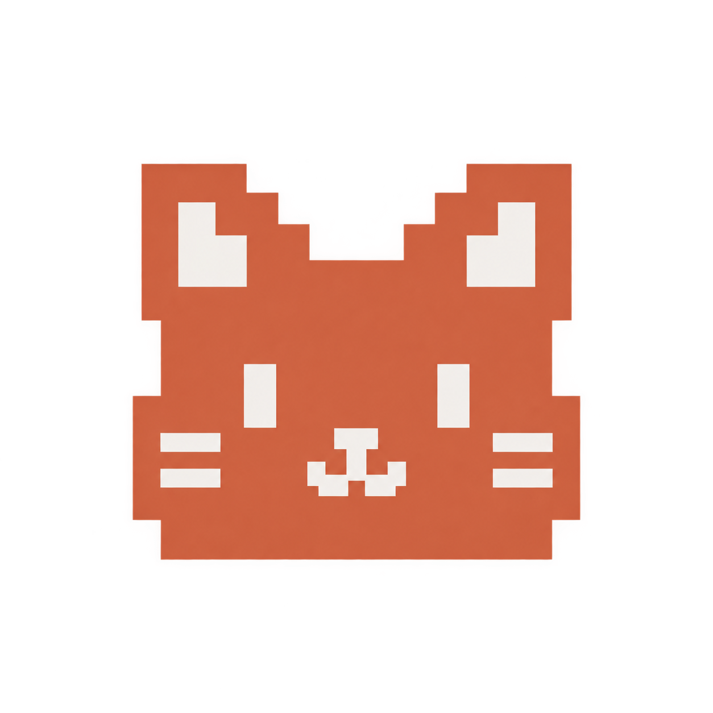
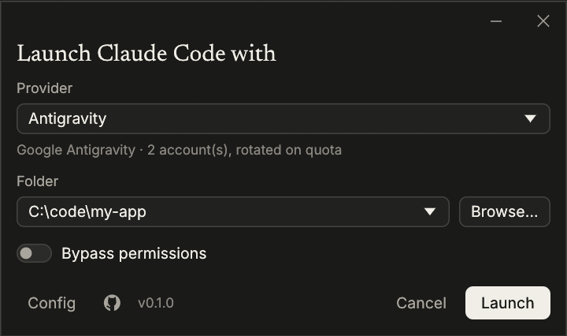

<p align="center"></p>

# ccat

**Claude Code, any model.** ccat is a small native launcher written in Rust: pick a provider and a folder, and it runs `claude` in your terminal against that provider. The main target is **Google Antigravity**: your Google accounts' Antigravity quota (Gemini, Claude, GPT-OSS) behind the Claude Code harness you already know. Any Anthropic-compatible endpoint works as well.

<p align="center">
  
  &nbsp;
</p>

```
ccat              # pick a provider/model per tier + folder, then Claude Code starts in this terminal
ccat --resume     # extra arguments go straight to claude
ccat --version    # the only flag ccat keeps for itself
```

ccat never edits your Claude config. Every override lives only in the child process's environment and flags, so a plain `claude` session stays exactly as it was.

## Why

- **All in one app.** No editing `settings.json`, no exporting `ANTHROPIC_BASE_URL` / `ANTHROPIC_AUTH_TOKEN` / model variables by hand. URLs, keys, Google accounts and per-tier models live in profiles you set up once in the UI. Switching between them is one click before launch.
- **A proxy built in.** Antigravity is served by a proxy inside ccat itself. For this use case you don't need a separate router such as 9Router or OmniRoute to sit between Claude Code and the model.
- **Claude Code on Antigravity.** Antigravity's quota is generous, but its agent isn't Claude Code. ccat gives you both: Claude Code's skills, hooks, plugins, subagents, MCP servers and permission model, running on Antigravity models, plus the Antigravity abilities Claude Code has no tool for.
- **Small and fast.** One native Rust binary: egui UI, plain blocking HTTP, no Node, no Python, no Docker, no background service. The proxy is a thin translation layer that only runs while your Claude Code session does.

## ccat vs Antigravity

What Antigravity (the IDE / `agy` CLI) offers, and where ccat stands on each:

| Capability                            |      Antigravity      |  ccat (Claude Code)  | Notes                                                                   |
| ------------------------------------- | :-------------------: | :------------------: | ----------------------------------------------------------------------- |
| Gemini models                         |          ✅           |          ✅          | Served by ccat's local proxy                                            |
| Claude / GPT-OSS on Antigravity quota |          ✅           |          ✅          | Same Cloud Code backend, same quota buckets                             |
| Agent harness                         |   Antigravity agent   |    ✅ Claude Code    | Skills, hooks, plugins, subagents, MCP, plan mode, `/context`           |
| Web search (Google Search)            |          ✅           |          ✅          | Google Search grounding; see [Special features](#special-features)      |
| Image generation / editing            |  ✅ `generate_image`  |          ✅          | Bundled MCP tool `mcp__antigravity__generate_image`                     |
| Several Google accounts               | One signed-in account |          ✅          | Pool with automatic rotation when one runs out                          |
| Quota in the status line              |      ✅ built-in      |          ✅          | `statusline/` script, next to your Claude plan limits                   |
| Third-party providers                 |      Google only      |          ✅          | Any Anthropic-compatible endpoint (OpenRouter, gateways, local servers) |
| Exact token counts                    |          ✅           | ✅ Gemini / ≈ others | Google's counter on Gemini routes; a calibrated estimate elsewhere      |
| Browser agent                         |          ✅           |          ❌          | Not bridged. Use a browser MCP server in Claude Code instead            |
| Knowledge / "brain" memory            |          ✅           |          ➖          | Claude Code has its own memory (`CLAUDE.md`, auto memory)               |
| Voice input, remote control           |          ✅           |          ❌          | Not bridged                                                             |

✅ supported · ➖ covered differently by Claude Code · ❌ not supported

## Special features

- **Antigravity Web Search.** Claude Code's `WebSearch` runs as Google Search grounding, and the results come back as Anthropic web-search blocks, so citations and follow-up `WebFetch` work as usual. Grounding only runs on Gemini, so a search asked of a Claude or GPT route is delegated to Gemini Flash and the result goes back to the model you picked.
- **Image generation and editing.** ccat registers an `antigravity` MCP server with Claude Code. Its `generate_image` tool uses Gemini's image model and can take existing images as references. Files are saved relative to your project folder.
- **Cache-aware Antigravity account pool.** Add as many Google accounts as you like. A recent observed cache hit on the same model and matching prompt/history prefix prefers that account; otherwise the pool spends usable quota with the earliest reset across its 5-hour and weekly windows. Both windows must have quota. Free-to-paid plan order breaks remaining ties or serves as the fallback when usage is unknown. Disabled accounts and backend quota blocks always win over cache affinity; retry delays come from Google. Cache hints are bounded, in-memory evidence for the current proxy (5-minute idle horizon, not a claimed backend TTL), not stored prompt caches or a cross-process server-cache inventory. Usage snapshots older than 10 minutes stop excluding accounts; an expired reset is probed rather than assumed refilled.
- **A provider per tier, switchable while it runs.** Fable, Opus, Sonnet and Haiku each pick their own `provider / model`: for example Fable and Opus on your official Claude login, Sonnet on Antigravity, Haiku on OpenRouter. Change a tier under **Settings → Models & tiers** and running sessions use it from their next request. Each tier is its own group of cards, with an ordered **fallback chain** (arrows move a model up or down in priority, an *Add fallback* card appends one), tried in turn when its provider is down or out of quota. A whole setup of the four tiers is a **configuration**: switch, duplicate, rename, import or delete them from the selector beside the page title in **Settings → Models & tiers** (and above the tiers in the launcher); each is a small file in `%APPDATA%\ccat\profiles\`. Claude tiers keep Claude Code's own login and plan limits; the local proxy only forwards them. The provider pages (**Settings → Claude**, **Antigravity**, **Codex**, **Ollama** and each endpoint) have an on/off switch: off hides it from the pickers and stops routing to it, live in running sessions.
- **Routing safeguards.** **Settings → Routing** has *Wait out usage limits* (when every route and fallback of a request is at its limit, the request waits instead of failing; Esc still cancels) and *Never fall back to a paid API key* (custom endpoints are skipped as fallbacks; a tier's own first choice still runs). A circuit breaker skips a provider for 30 s after 3 consecutive 5xx or timeouts, then lets one request probe it; 429s never trip it, and if every route is skipped all of them are tried.
- **Compact earlier on non-Claude models.** A tier shown under a Claude name gets that model's context window (often 1M), so Claude Code would only auto-compact near ~967k tokens and long sessions turn slow. **Settings → Routing** sets a size (default 200k, 128k to 400k, off with the switch) that ccat passes as `CLAUDE_CODE_AUTO_COMPACT_WINDOW` to routed sessions with such a tier. It applies at launch only, and your own `CLAUDE_CODE_AUTO_COMPACT_WINDOW` wins.
- **Dashboard, Analytics and History.** Under **Settings → Insights**: **Dashboard** is the tray's Live chart, roomy: one area per model or provider over the last hour, today, 24 hours, this week, 7 days, 31 days or all time (the bucket size adapts), tokens, calls or cost, optionally cumulative, with a running list of totals and shares, a few figures and a mark on whatever is being served right now; it refreshes by itself (`ccat --ccat-settings dashboard`). **Analytics** charts what the proxy logged (`%APPDATA%\ccat	okens.jsonl`) by day, or by hour for 24 h, over 24 h to all time, filtered by provider, tier and model, grouped by model, provider, tier or day, with requests, tokens, cache hit rate, an API-equivalent cost estimate, average latency and a table of shares. **History** lists the individual requests, newest first, with time, model, tokens, how long each took, stop reason and account, a search box, filters and *Load more*. Each request is logged with its duration (`ms`), the proxy's `pid`, its stop reason and the pooled account that served it; older lines without them still show.
- **Token saving.** **Settings → Token saving** has an opt-in *Compress tool output (third-party models)*: a lossless cleanup of Bash/PowerShell command output only (ANSI colours, progress redraws rendered like a terminal, trailing spaces, runs of identical lines). It is deterministic, so provider prompt caches keep hitting, and it never touches Claude, error results or file reads.
- **Claude names for any model.** A non-official tier can be presented to Claude Code under a Claude model name. Claude Code then applies that model's catalog entry (context window, thinking), while the request still goes to the real model.
- **Faithful translation.** Streaming and non-streaming Messages ↔ Cloud Code `streamGenerateContent`, thinking blocks and their signatures (safe across model switches and resumed sessions), and tool schemas normalized to what every Antigravity model family accepts.
- **Quota status line.** One PowerShell script feeds both status lines: in `agy` it records the quota Antigravity hands it, and in Claude Code it shows that quota next to context use and your Claude plan limits, as smooth bars:

  ```
  ◔ ▌░░░░░░░ 7% │ ✻ Claude 5h █▉░░░░░░ 24% 7d ████▍░░░ 55% │ ▲ ◇ Claude/GPT 5h ▏░░░░░░░ 2% 7d ▎░░░░░░░ 3%
  ```

  The Gemini bucket shows in `agy`'s line only. The Claude/GPT bucket (`◇`) appears only when a tier runs a non-Gemini model on Antigravity.

- **Usage tray (Windows).** While any ccat runs, one tray icon shows your quota as a dial: Claude's 5-hour percent above, Antigravity's below, each inside a half ring of its weekly use (one source alone takes the whole dial). Click it for the window: **Usage** lists every Claude limit and Antigravity's Gemini and Claude groups (all Google accounts combined or one at a time), and **Analytics** charts the tokens ccat's proxy has seen per day by model or provider. Its gear button, like the launcher's settings button and the icon's right-click **Settings**, opens the Settings window (`ccat --ccat-settings [page]`, one instance), where tier models and configurations switch live. However many ccat sessions run, there is one icon and one usage window. Claude's numbers come from Claude Code's own login, which ccat reads but never refreshes.
- **Stays current.** The backend gates newer models on the client version, so ccat reports the live Antigravity release version, and the list of Claude model names comes from [models.dev](https://models.dev), checked at most every six hours.

## Providers

| Provider                                   | What it does                                                                                                                                                                                                      |
| ------------------------------------------ | ----------------------------------------------------------------------------------------------------------------------------------------------------------------------------------------------------------------- |
| **Claude** (official)                      | Your normal Claude Code login. A tier left at Claude with Claude Code's pick changes nothing; all four there is plain `claude`.                                                                                     |
| **Google Antigravity**                     | Sign in with one or more Google accounts in the browser. ccat provisions the Cloud Code project, lists the models your accounts can use, and serves them through a local proxy while Claude Code runs.            |
| **Codex (ChatGPT plan)**                   | Your ChatGPT Plus/Pro plan behind Claude Code: the GPT models Codex uses, through ccat's own Sign in with ChatGPT, in Official or Codex (Legacy) mode. See [Codex](#codex) and [ccat vs Codex](#ccat-vs-codex).                                         |
| **Ollama Cloud**                           | Ollama's hosted models (Kimi, GLM, DeepSeek, Qwen, GPT-OSS…) with an API key from [ollama.com/settings/keys](https://ollama.com/settings/keys). ccat translates Anthropic Messages to Ollama's native `/api/chat` (tools, images, thinking with effort mapped to low/medium/high), runs `WebSearch` on Ollama's web search, and shows your credit balance. Cloud only: local Ollama servers are not supported. See [ccat vs Ollama Cloud](#ccat-vs-ollama-cloud). |
| **Gemini Web** (native)                    | Your Google Gemini Web session integrated directly into ccat as a 100% native in-process Rust provider (zero external binaries, Python, Playwright, or localhost bridge servers). Speaks the native Anthropic Messages API with streaming SSE, tools, and token counting directly to Google's batchexecute endpoints. Accounts and DPAPI-encrypted credentials live in `%APPDATA%\ccat\gemini_web\accounts`. Sign in natively using Chrome or Edge over WebSocket CDP. Supports Gemini 4 Argon, Gemini 3.1 Pro, and Gemini 3.8 Flash using your Google accounts. |
| **Anthropic-compatible endpoint** (custom) | Any server that speaks the Anthropic Messages API: OpenRouter, an API gateway, a local model server. Set a URL and key, **Fetch model list** (Anthropic- or OpenAI-style `/v1/models`), or type custom model ids. Claude Code's per-request billing line is stripped from the system prompt so the endpoint's prompt cache sees a stable prefix. |
| **OpenAI-compatible endpoint** (custom)    | Turn on **OpenAI-compatible** on an endpoint's page and ccat translates Anthropic Messages to Chat Completions (`<url>/chat/completions`, streamed; tools, tool results, images, reasoning text). The URL is the provider's versioned base (`…/v1`). A new endpoint offers one-click presets for providers with free tiers or keys: **NVIDIA NIM**, OpenRouter, Groq, Google AI Studio, Cerebras, Mistral, OpenCode Zen and Go, each with a *Get API key* link. **Only free models** keeps the ids named free (`:free`, `-free`). `max_tokens` and reasoning effort are not sent. |
| **OpenCode Free** (special)                 | A built-in anonymous provider, separate from regular API-key endpoints. Enter its versioned provider URL in **Settings → OpenCode Free** and fetch the free models; no API key or account is needed. Requests use Bun's HTTP transport (the installed OpenCode runtime, or Bun on PATH) and the anonymous `public` marker, not your local gateway token. The adapter is adapted from [zen-proxy](https://github.com/12errh/zen-proxy), MIT, including tool translation (`read` → `Read`). Direct and HTTP(S) outbound pools are configurable; source-IP binding and SOCKS5 are explicitly unsupported rather than silently ignored. Upstream access restrictions and limits still apply; a 429 is not proof of exhausted device quota. Free-only refusals are surfaced instead of silently held. It stays eligible when **Never fall back to a paid API key** is on. |

Providers are connections: add, rename, turn off and delete them in **Settings** (the sidebar lists Claude, the built-ins and each endpoint, plus **+ Add endpoint**; the launcher's settings button opens it), then pick `provider / model` for each tier in the launcher. With every tier on Claude and no fallback, ccat runs plain `claude`, straight to Anthropic; anything else goes through the local proxy, which is what lets a session switch models and fall back while it runs.

## Codex

Use your ChatGPT plan, not an API key, for the GPT models. ccat signs in **by itself**, with OpenAI's official [Sign in with ChatGPT](https://developers.openai.com/siwc/token-sharing-open-source): the **+** under **Settings → Codex** opens your browser, you approve once, and ccat keeps and refreshes its own tokens (in `%APPDATA%\ccat\chatgpt`, never in `config.json`). It does not read or touch Codex CLI's `~/.codex` files, and your Codex login is not affected. If a sign-in is revoked or expires, ccat says so instead of retrying.

One sign-in serves both modes, picked with the **Official / Codex (Legacy)** switch on the same page (followed live by running sessions):

| | Official | Codex (Legacy) |
| --- | --- | --- |
| Endpoint | `api.openai.com/v1/responses`, documented by OpenAI for this sign-in | `chatgpt.com/backend-api/codex/responses`, the way Codex CLI sends requests; undocumented, so it may change |
| Limits | Counts toward the per-app cap you set in ChatGPT settings → Usage | Your plan's own 5-hour and weekly limits |
| Usage numbers in ccat | None: the usage window says so and links to [chatgpt.com/settings/usage](https://chatgpt.com/settings/usage) | The session (5 h) and weekly bars, as Codex shows them |
| Tools | Sent inside a namespace (the official route requires it) | Plain function tools, as Codex sends them |
| Large requests | Sent as they are | zstd-compressed above 256 KiB, as Codex does |

ccat first tries the same sign-in on the Codex backend. If that backend refuses it, the account shows **Codex (Legacy) needs its own sign-in**; the optional **Sign in for Codex (Legacy)** then signs in with Codex's own client. That second sign-in works only in Legacy mode, and OpenAI may sign Codex CLI out on your other devices when it is used, so it is never started unless you click it. Official mode keeps working with the first sign-in either way.

Accounts an older ccat copied from Codex CLI stay in the list as **Codex CLI (legacy import)** but have no token any more; sign in with ChatGPT to replace them. A config with a Codex-client sign-in starts in Legacy mode; a new one, or one with only those leftover imports, in Official.

Both modes send the Claude Code session as the cache key (`session-id`, `thread-id`, `prompt_cache_key`), so a session's turns share a prompt cache, and a conversation the model finds too long is answered as Claude Code's own "prompt is too long" so it compacts and goes on.

## ccat vs Codex

What Codex (the CLI / app) offers on a ChatGPT plan, and where ccat stands on each:

| Capability                         |        Codex         |  ccat (Claude Code)  | Notes                                                                                   |
| ---------------------------------- | :------------------: | :------------------: | --------------------------------------------------------------------------------------- |
| GPT models on your ChatGPT plan    |          ✅          |          ✅          | The list your account gets, display names included                                      |
| Reasoning effort                   | ✅ low … max, ultra  |   ✅ low … max       | Claude Code's `/effort` maps 1:1; no effort = the model's Codex default. *Ultra* (Codex's own task delegation) isn't sent |
| Fast mode (priority tier)          |          ✅          |          ➖          | Off on purpose: ccat never asks for the priority tier                                   |
| Web search                         |          ✅          |          ✅          | Claude Code's `WebSearch` runs as the Responses `web_search` tool, with citations         |
| Image input                        |          ✅          |          ✅          | Screenshots and pasted images reach the model                                           |
| Image generation                   |          ✅          |          ❌          | Not bridged yet                                                                          |
| Reasoning carried across turns     |          ✅          |          ✅          | Encrypted reasoning is replayed; it never leaks to Anthropic routes                      |
| Prompt caching                     |          ✅          |          ✅          | Keyed on the Claude Code session                                                         |
| Usage limits (5 h / weekly)        |          ✅          |   ✅ Legacy only     | Usage window and tray dial in Codex (Legacy) mode; Official has no numbers                                                            |
| Fallback when ChatGPT is limited   |          ❌          |          ✅          | Fallbacks to Claude, Antigravity or any endpoint per tier                               |
| Agent harness                      |     Codex agent      |    ✅ Claude Code    | Skills, hooks, plugins, subagents, MCP, plan mode                                        |
| `AGENTS.md`, sandbox, approvals    |          ✅          |          ➖          | Claude Code's `CLAUDE.md`, permission modes and *Bypass permissions*                     |
| `/review`                          |          ✅          |          ➖          | Claude Code's code-review commands and plugins                                           |
| Compaction                         |   ✅ server-side      |          ➖          | Claude Code compacts the conversation itself                                             |
| Cloud tasks, remote control        |          ✅          |          ❌          | Not bridged                                                                              |
| Mixing with Claude, Gemini, others |          ❌          |          ✅          | One tier on GPT, another on Claude or Antigravity, switchable while a session runs       |

✅ supported · ➖ covered differently by Claude Code · ❌ not supported

## ccat vs Ollama Cloud

What Ollama's own Claude Code setup offers (`ollama launch claude`, or Claude Code pointed straight at `https://ollama.com/v1/messages`), and where ccat stands on each. ccat talks to Ollama Cloud only; a local Ollama server is not supported.

| Capability                          | Ollama `/v1/messages` |  ccat (Claude Code)  | Notes                                                                                                   |
| ----------------------------------- | :-------------------: | :------------------: | ------------------------------------------------------------------------------------------------------- |
| Ollama Cloud models                 |          ✅           |          ✅          | **Fetch** lists `ollama.com/api/tags`, keeping only models that can call tools                          |
| Tool calling                        |          ✅           |          ✅          | Native `/api/chat` tools; results matched back by tool name                                             |
| Deferred tools (`ToolSearch`)       |          ➖           |          ✅          | Ollama: "not fully supported". ccat resolves discovered tool definitions before sending                 |
| Thinking / effort                   |          ✅           |   ✅ low … high      | `/effort` maps to `think`; xhigh and max ask for high. A model without thinking is retried without it     |
| Web search                          |          ➖           |          ✅          | Ollama: hosted web search "not fully supported". ccat runs `WebSearch` on `ollama.com/api/web_search` with the same key |
| Image input                         |          ✅           |          ✅          | Base64 images                                                                                           |
| Prompt-cache hits reported          |          ❌           |          ✅          | `prompt_eval_cached_count` shows as cache reads in Claude Code and ccat's analytics                     |
| Token counting                      |          ❌           |          ≈           | A calibrated estimate (Ollama has no `count_tokens`)                                                    |
| Balance and limits                  |   ollama.com only     |          ✅          | `/api/balance`: monthly included credits, session / weekly on legacy plans, purchased credits; Settings and tray |
| Free models                         |          ➖           |          ➖          | None: every cloud model is billed per token ([pricing](https://ollama.com/pricing)). Free models of other providers carry a green **Free** badge in the selectors |
| Fallback when credits run out       |          ❌           |          ✅          | A tier falls back to Claude, Antigravity, Codex or an endpoint                                          |
| Mixing with Claude, Gemini, GPT     |          ❌           |          ✅          | One tier on Ollama Cloud, another on Claude, switchable while a session runs                            |
| Local models                        |          ✅           |          ❌          | Dropped: ccat is cloud-only for Ollama                                                                  |

✅ supported · ≈ estimated · ➖ partial or not applicable · ❌ not supported

Unit-test builds store ccat configuration under a process-specific temporary directory, including launcher shutdown saves. They never save test profiles to the installed app's configuration.

Claude Code's `ENABLE_TOOL_SEARCH=true` loads tools on demand. ccat resolves discovered tool definitions for Codex, Antigravity and Ollama, preserving their schemas and tool results. Official Claude requests are forwarded unchanged. Setting tool search to `false` loads every MCP definition upfront and can substantially increase context size.

## Backup & restore

Open **Settings → Backup & restore** on **This PC** to export or import a full ccat backup. It includes all ccat-managed provider accounts and credentials, API keys, named routing configurations, cloud machine connections, gateway settings, and app preferences. Gemini cookies are decrypted for transfer and encrypted again for the destination Windows user.

**Backups are unencrypted and contain login secrets. Keep them private; never commit or share them.** Import validates the entire backup before writing, asks for confirmation, replaces matching saved files, and leaves unrelated local files in place. Close other ccat sessions before restoring and relaunch them afterward. A failed restore attempts to roll back every file it touched and reports any rollback failure.

Claude Code's own login, environment-variable secrets, browser profiles, remote machine mirrors, logs, caches, and runtime state are not included. Sign in to Claude Code separately on a new machine; restore any external proxy environment variables separately. Existing single-routing-configuration import remains available in the configuration menu.

## Install

You need [Claude Code](https://docs.claude.com/en/docs/claude-code) (`claude`) on your `PATH`. ccat itself is a single native binary (`ccat` on macOS/Linux, `ccat.exe` on Windows).

**macOS & Linux** (from source via Cargo):

```bash
git clone https://github.com/duongnguyen16/ccat
cd ccat
cargo install --path .
```

Ensure `~/.cargo/bin` is in your `PATH` (typically added automatically by `rustup`). Verify with `ccat --version`.

**Windows** (winget):

```powershell
winget install duongnguyen16.ccat
```

> The winget package was submitted to [microsoft/winget-pkgs](https://github.com/microsoft/winget-pkgs/pulls?q=duongnguyen16.ccat) and goes live once that review is merged. Until then, use one of the options below.

**Download:** grab `ccat-v<version>-x86_64-windows.zip` or the macOS binary from the [latest release](https://github.com/duongnguyen16/ccat/releases/latest), unzip it, and put the binary somewhere on your `PATH`. On Windows, the binary is not code-signed, so Windows SmartScreen may ask you to confirm the first run.

Check it with `ccat --version`. Then run `ccat` in any terminal: add your first provider in **Settings**, pick a folder and press **Launch**.

Officially supports **macOS** and **Windows**. The UI (egui) and the proxy run natively on both platforms.

### Status line (optional)

#### macOS / Linux (bash / zsh)

Claude Code, in `~/.claude/settings.json`:

```json
"statusLine": {
  "type": "command",
  "command": "/path/to/ccat/statusline/quota-statusline.sh"
}
```

Antigravity CLI, in `~/.gemini/antigravity-cli/settings.json` (or run `/statusline <command>` inside `agy`):

```json
"statusLine": {
  "enabled": true,
  "command": "/path/to/ccat/statusline/quota-statusline.sh -Agy"
}
```

#### Windows (PowerShell)

Claude Code, in `~/.claude/settings.json`:

```json
"statusLine": {
  "type": "command",
  "command": "powershell -NoProfile -ExecutionPolicy Bypass -File C:/path/to/ccat/statusline/quota-statusline.ps1"
}
```

Antigravity CLI, in `~/.gemini/antigravity-cli/settings.json` (or run `/statusline <command>` inside `agy`):

```json
"statusLine": {
  "enabled": true,
  "command": "powershell -NoProfile -ExecutionPolicy Bypass -File C:\\path\\to\\ccat\\statusline\\quota-statusline.ps1 -Agy"
}
```

The Antigravity quota refreshes whenever `agy` is open. A dim `~Nh` marks a reading that is N hours old. Bars turn yellow at 50% and red at 80%.

## How it works

```
claude ──► ccat proxy (127.0.0.1, random port, per-launch token)
             ├─ POST /v1/messages, by the model's tier:
             │    ├─ Antigravity tier ──► Cloud Code streamGenerateContent ──► Anthropic SSE back
             │    ├─ endpoint tier    ──► that endpoint, with its key
             │    └─ official tier    ──► api.anthropic.com, with Claude Code's own login
             ├─ count_tokens          ──► same routes (Google countTokens / calibrated estimate on Antigravity)
             └─ /mcp                  ──► generate_image (Gemini image model)
```

- Official Claude request bodies are forwarded byte-for-byte as Claude Code sent them, with its headers (hop-by-hop ones aside). Only when a tier swaps the model, or another provider's thinking must be dropped, is the body rewritten, keeping key order.

- The proxy binds to `127.0.0.1` only, on a random port. Antigravity and endpoint tiers spend your accounts and keys, so they answer only requests carrying the token generated for that launch (sent as an `x-ccat-token` header). Official tiers carry only the caller's own login.
- Several ccat sessions can run at once: each has its own proxy, which follows model changes in the config; the config is saved atomically and merged field by field, and log lines carry the process id. Token counts for **Analytics** go to `tokens.jsonl` next to the config, one line per request.
- Config, including the Google refresh tokens, is stored in `%APPDATA%\ccat\config.json` (`$XDG_CONFIG_HOME/ccat` or `~/.config/ccat` elsewhere). Keep that file private.
- Proxy logs go to `antigravity.log` next to the config, since Claude Code owns the terminal while ccat runs.

### Source layout

- `src/proxy/`: `mod` (routing, fallback chains, breaker use), `http`, `sse`, `compress` (tool-output cleanup), `breaker`.
- `src/providers/`: `claude`, `endpoint`, `antigravity/`, `chatgpt/`, `ollama`. Each owns its auth, translation, pooling, web search, usage and its Settings page.
- `src/settings/`: the Settings window, its sidebar (with its icons) and the provider editor state its provider pages share, plus the Dashboard, Analytics and History pages (`insights.rs`, `insights/dashboard.rs`).
- `src/common.rs`: helpers shared across the above.

## Notes

- Antigravity's Cloud Code API is internal and undocumented. Request shapes follow oh-my-pi's `google-antigravity` provider and may break when Google changes them.
- Use your own accounts, within Google's terms for Antigravity.

## License

[MIT](LICENSE). The bundled fonts (Inter, JetBrains Mono, Newsreader) are under the [SIL Open Font License 1.1](font/OFL.txt).
