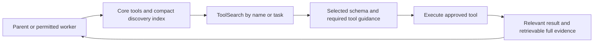

# Claude Code token-saving plan — preserve result quality

Date: 2026-10-24 (Asia/Bangkok).

## Outcome and scope

Optimize repeated context, retrieval and failed work before changing models or reasoning effort. Keep integrations discoverable, maintain permission boundaries and verification, and retain the full evidence needed to finish the task. This is an evidence-based plan, not a promise that every context reduction has zero quality risk. Each proposed change has an acceptance gate.

Inspected the 20 most recently updated top-level Claude transcripts (172.5 MB), 16,513 ccat usage records, ccat error/wait logs, user settings, legacy metadata, global instructions/rules and enabled plugin hooks/agent definitions. ccat history covers 2026-10-20T20:46:34+07:00 through 2026-10-24T15:43:50+07:00. Subagent transcript trees were not exhaustively scanned.

## Already enabled and verified

```json
{
  "env": {
    "ENABLE_TOOL_SEARCH": "true",
    "CLAUDE_CODE_USE_POWERSHELL_TOOL": "1"
  }
}
```

Location: `C:\Users\duncuti16\.claude\settings.json`. The legacy `ENABLE_TOOL_SEARCH=false` entry was removed from `C:\Users\duncuti16\.claude.json` in the previous change. All other settings remain intact.

PowerShell: native tool flag is on; the user WindowsApps `pwsh.exe` reports 7.6.8 (the Codex execution runtime also provides 7.6.5). The sampled real Claude history contains 459 PowerShell results, 412 not marked as tool errors and 47 marked as errors. Those errors can include expected negative tests; they are not proof of shell defects. No setting rewrite is needed merely to re-enable an already enabled tool. Keep Bash available for existing plugin hooks that explicitly use Bash.

Tool search: the previous controlled capture reduced upfront declarations from 127 to 17, tool JSON from 264,603 to 43,701 characters (83.5%), and the whole request from 323,831 to 110,931 characters (65.7%). These are payload-size measurements, not measured bill savings. ccat now resolves discovered schemas for MuseAI, ChatGPT, Antigravity and Ollama. Official requests retain their original protocol.

## Evidence that changes the priorities

| Finding | Evidence | Meaning |
|---|---|---|
| Long text results | 92 results contain at least 10,000 text characters; largest 50,000 | Retrieve relevant sections and preserve full artifacts rather than repeatedly feeding whole pages |
| Reads dominate retrieval | 1,443 Read calls; 2,925,756 text characters | Targeted search and bounded source ranges are a larger opportunity than shortening a small global rules file |
| Image accounting | Read results include 22 media blocks and 2,095,628 base64 characters | Do not estimate image tokens as base64 characters / 4 or discard screenshots to improve a text metric |
| Official cache use | 96.3% of reported input in 1,316 official-Claude ccat records is cache-read input | Preserve stable prefixes and cache eligibility; distinguish cached input from fresh input and billing |
| Shell output coverage | Baseline RTK matcher was Bash; PowerShell has 459 calls | Native RTK hook now covers Bash|PowerShell after nine self-checks |
| Startup injection | Prior request carried ~31,281 characters of MCP instructions inside a ~46k startup message | Move user-controlled detail to on-demand skills; retain instructions required by tools when those tools load |
| User rules are small | CLAUDE.md ~1,057 characters; RTK.md ~955; Context7 rule 1,679 bytes | These are useful policy, not the main source of bloat |
| Agent tool scope | feature-dev packaged agents use fixed allowlists without ToolSearch or PowerShell | Check role-specific discovery access; global parent settings alone do not establish each agent’s tool permissions |
| Retries/waits | Historical logs contain 50 retry entries, 105 all-routes-held entries and 5 schema-error entries | These are log-entry counts, not unique billable attempts; keep preflight validation and instrument real retries |

## Recommended order

| Priority | Change | Expected saving | Quality gate / preservation rule | State |
|---|---|---|---|---|
| P0 | Keep global on-demand tool search | Largest measured reduction; applies to official Claude and translated providers | ToolSearch must reveal the real selected schema and allow a complete tool-result follow-up; retain integrations and permissions | Enabled; adapter regressions and live Muse round trip passed previously |
| P1 | Use search-first, range-based retrieval and tool-specific output summaries | Reduce the 92 large text results and repeated file/page dumps | Keep filenames, line numbers, relevant errors, complete failing-test diagnostics and the retrievable raw source/artifact. Expand ranges whenever needed to understand callers or invariants | Applied in user token-efficiency rule |
| P1 | Cover PowerShell output deliberately | Avoid future unfiltered build/status/log output as Windows work moves to PowerShell | Test exit-code propagation, stderr, Unicode, spaces, pipelines and failing commands. Keep full raw logs. Do not blindly route PowerShell syntax through the Bash hook | Applied: native RTK matcher Bash and PowerShell; nine checks passed |
| P1 | Keep parent/worker tool discovery role-aware | Avoid full tool catalogs in every worker; avoid broken discovery in restricted agents | General workers may inherit the parent’s ToolSearch. Add discovery and specific approved tools only where the role needs them; read-only reviewers stay read-only. Validate actual available tool names | Applied in user token-efficiency rule |
| P2 | Slim user-controlled startup injection with progressive disclosure | Reduce repeated skill/catalog boilerplate | Keep a short always-on policy, project invariants and safety requirements; load detailed skills/references on trigger. Preserve required vendor MCP instructions when a tool loads. Measure actual /context categories first | Pending actual context measurement; vendor guidance preserved |
| P2 | Preserve stable caching and compact at meaningful checkpoints | Reduce repeated cache creation and unnecessary history replay | Preserve tool ordering, model/session cache keys and stable policy. Keep current goals, constraints, decisions, changed files, failing checks and pending tool IDs through compaction. No blind truncation or global early-compaction threshold | Applied in user token-efficiency rule |
| P2 | Measure native-provider consumption honestly | Expose costs hidden by missing usage | Record provider, active tools, request characters, retries and reported/estimated/unavailable usage separately. Count requests even when token usage is unknown. Keep credentials and raw prompts out of routine metrics | Partial: request sizes and native duration/status; billed usage unavailable |
| P3 | Consider optional browser/plugin profiles and duplicate integrations | Smaller baseline once main overhead is fixed | Browser registration is enabled globally; retain an easy path for real browser tasks. Consolidate duplicate Context7 registration only after resolve/query/auth tests. Keep its current-documentation rule | Optional, not applied |

## Tool discovery flow



Do not put every server schema into the prompt to make tools discoverable. Keep the discovery mechanism, then load the selected definition. Retain complete selected schemas and argument validation: a smaller prompt that makes the model guess parameter names is a quality regression.

## Current configuration findings

| Source | Observation | Proposed handling |
|---|---|---|
| `.claude/settings.json` | Tool search true; native PowerShell 1; saved model Haiku, effort high, Advisor Opus | Preserve chosen quality controls; do not automatically downgrade the model/effort or disable Advisor to claim savings |
| `.claude.json` | Legacy timeouts/watchdog; two standalone MCP servers; browser enabled by default | Leave retry/timeout choices intact while measuring; keep connector credentials out of the plan |
| `.claude/CLAUDE.md` + `RTK.md` + `rules/context7.md` | Short user policy and required current-doc lookup | Preserve; avoid redundant copies elsewhere |
| User PreToolUse hook | `rtk hook claude`, matcher Bash and PowerShell | Native hook verified against nine cases; preserves permission decisions |
| User PostToolUse/Stop hooks | Project action log and local notification | Preserve current behavior; commands themselves are not proof of model-token overhead |
| superpowers SessionStart | Runs on startup/clear/compact | Measure emitted context; keep detailed workflows in triggered skills/references rather than repeat their complete bodies |
| security-guidance | Startup/reminder hooks plus background review on Stop/commit | Preserve security review. Existing source already tracks reviewed diff hashes/commits; verify deduplication rather than implement another reviewer/cache |
| Context7 plugin + standalone server | Both registered; sampled calls used standalone resolve/query names | Consolidate only after testing discovery and authentication; keep docs quality |

## Agent allowlists

| Plugin / agent | Current tool scope |
|---|---|
| `code-simplifier@claude-plugins-official` / `code-simplifier` | `(inherits parent tools)` |
| `feature-dev@claude-plugins-official` / `code-architect` | `Glob, Grep, LS, Read, NotebookRead, WebFetch, TodoWrite, WebSearch, KillShell, BashOutput` |
| `feature-dev@claude-plugins-official` / `code-explorer` | `Glob, Grep, LS, Read, NotebookRead, WebFetch, TodoWrite, WebSearch, KillShell, BashOutput` |
| `feature-dev@claude-plugins-official` / `code-reviewer` | `Glob, Grep, LS, Read, NotebookRead, WebFetch, TodoWrite, WebSearch, KillShell, BashOutput` |

Packaged plugin cache files should not be patched as permanent configuration: updates can replace them. Use supported project/user agent definitions or an upstream plugin update. Check permissions as well as tool availability; enabling ToolSearch does not mean granting every discovered write tool to every agent.

## Acceptance checks before rolling out further reductions

| Scenario | Must still work |
|---|---|
| Simple question | Short answer, no unnecessary search/spawn, lower initial context |
| Bug fix | Read all relevant code/callers, edit correctly, run meaningful checks, report actual results |
| Library question | Discover Context7, resolve then query current docs, preserve source facts |
| Windows task | Native PowerShell executes; Unicode/paths/exit codes/stderr remain correct |
| MCP task | Parent and the appropriate worker discover the real schema, call it and consume its result |
| UI task | Screenshots remain available at adequate resolution; media tokens are accounted separately |
| Long task / compaction | Goals, constraints, user corrections, tests and pending work survive |
| Security-sensitive change | Required review, validation and permission checks remain in place |

Compare output correctness and completed work first. Track initial context, added text, cache creation/read, output tokens, tool calls, retries and time second. Revert a reduction that causes missing evidence, skipped tests, lost tool arguments or incorrect results. Do not assign a new savings percentage to an unbenchmarked recommendation.

## Measurements and limits

- [Detailed log metrics](claude-log-efficiency-metrics.json)
- [Previous request audit](claude-token-audit.md)
- [Full 245-tool inventory](claude-tool-token-inventory.csv)

Assistant usage is deduplicated by message id across the sample; tool calls/results by tool-use id. Raw serialized tool-result sizes are retained separately from text-only sizes. Reported log usage is not an invoice; cached tokens, aliases, provider telemetry gaps and missing request IDs limit billing conclusions. Current native Muse usage is not sufficiently reported for exact billed-token accounting. Follow-up changes enabled the verified native RTK PowerShell hook, added targeted retrieval/worker/cache/compaction guidance, and added non-secret request metrics. Native Muse records duration, status and explicitly unavailable usage; this is not full provider billing or retry attribution. Vendor startup-injection reduction remains pending measurement. Agent permission changes, plugin removals, model/effort changes and global compaction thresholds were not applied. See [implementation and timeout investigation](ccat-connectivity-and-timeout-fixes.md).

## Primary references

- [Claude Code tool search](https://code.claude.com/docs/en/mcp#configure-tool-search)
- [Claude Code settings](https://code.claude.com/docs/en/settings)
- [Claude Code changelog: native Windows PowerShell behavior](https://github.com/anthropics/claude-code/blob/main/CHANGELOG.md)
- [Agent and context/compaction API definitions](https://github.com/anthropics/claude-code/blob/main/mods/types/claude-code.d.ts)
- [Progressive-disclosure skills guidance](https://github.com/anthropics/claude-code/blob/main/plugins/plugin-dev/skills/skill-development/references/skill-creator-original.md)
